# Tote

A shopping list for Android, built with Jetpack Compose. Add what you need, group it by category, see what each category will cost, and tick things off as they go into the bag.

<p align="center">
  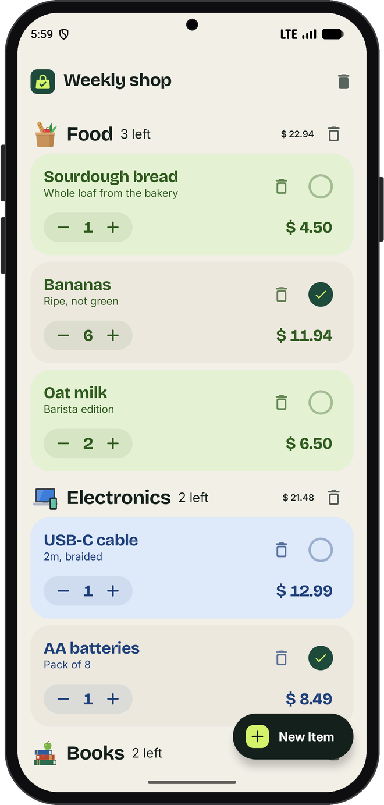
  &nbsp;&nbsp;
  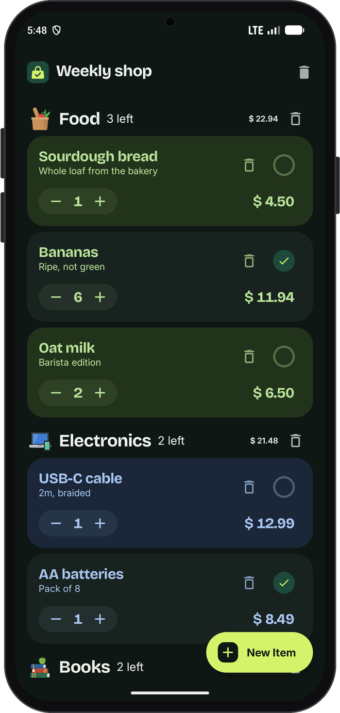
</p>

## Download

Get the latest APK from the [**Releases page**](https://github.com/narteyr/tote-bag/releases/latest).

To install it on an Android phone (Android 7.0 or newer):

1. Download `tote-v1.0-debug.apk` on the phone.
2. Open it. If Android blocks it, allow your browser or file manager to **Install unknown apps** when prompted.
3. Tap **Install**.

This is a debug build, meant for trying the app out. It isn't on the Play Store.

## Screenshots

### Launch

On start, Tote cycles through its category illustrations for three seconds, then opens the list.

<p align="center">
  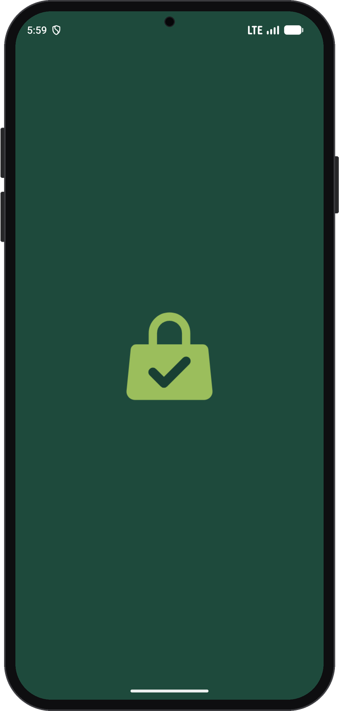
  &nbsp;
  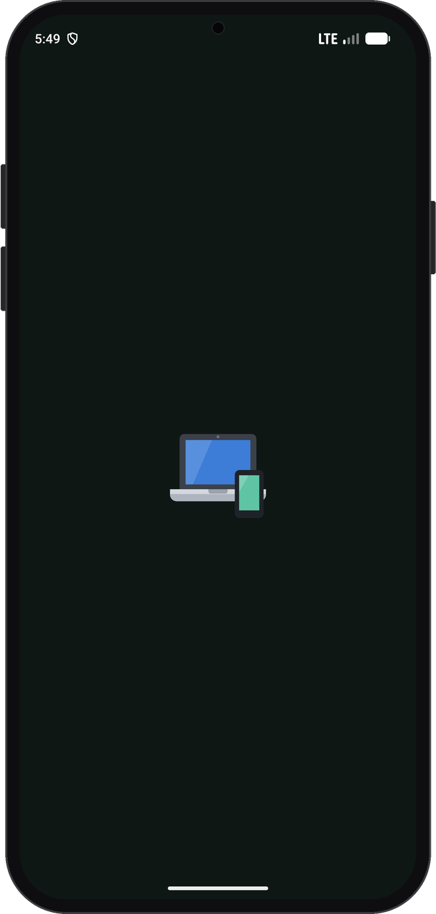
  &nbsp;
  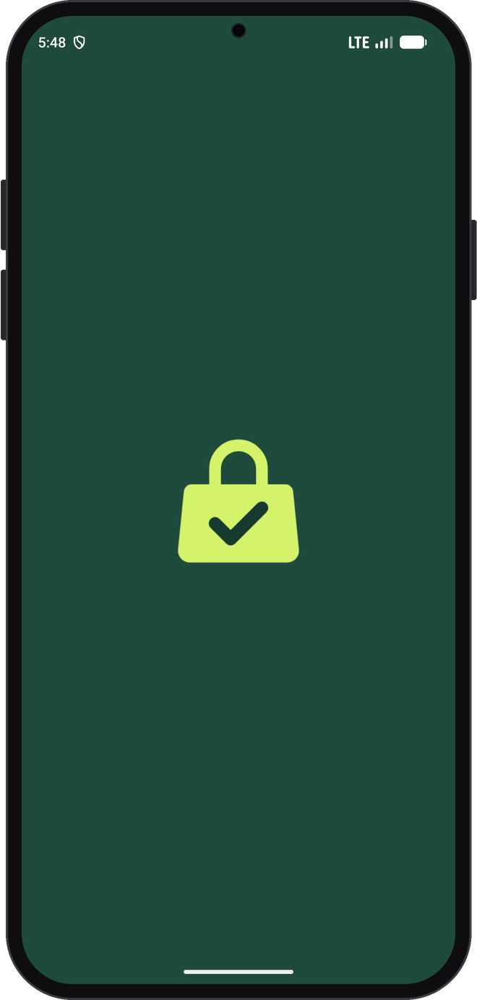
</p>

### Empty tote

<p align="center">
  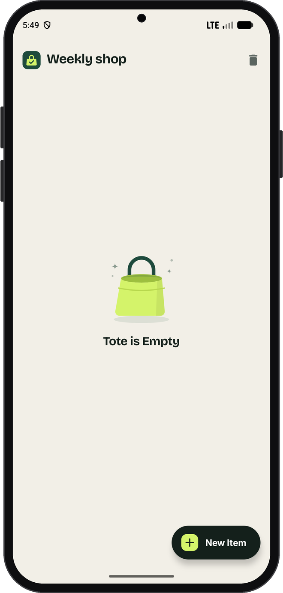
  &nbsp;
  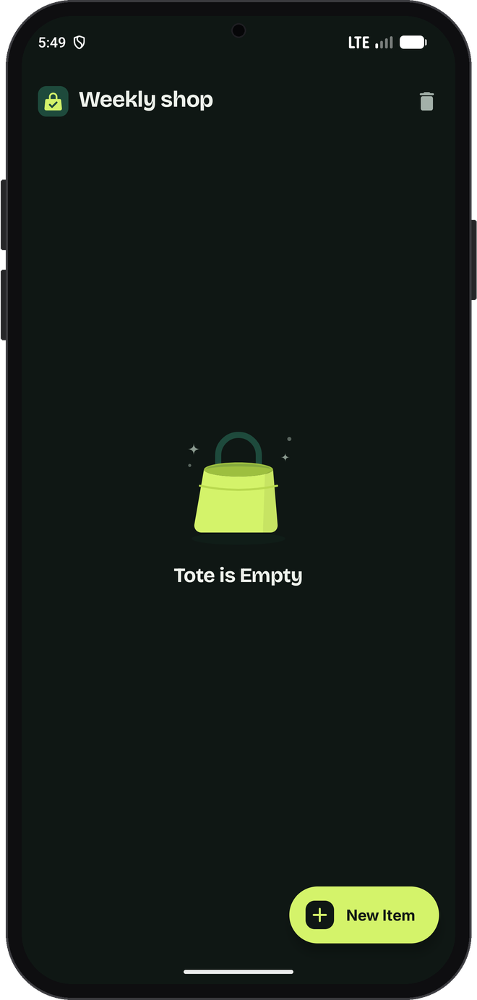
</p>

### Adding and editing items

The same dialog creates and edits items. The category picker shows each category's icon, and empty or invalid fields get a message under the field.

| New item | Category picker | Validation | Edit item |
|:---:|:---:|:---:|:---:|
| 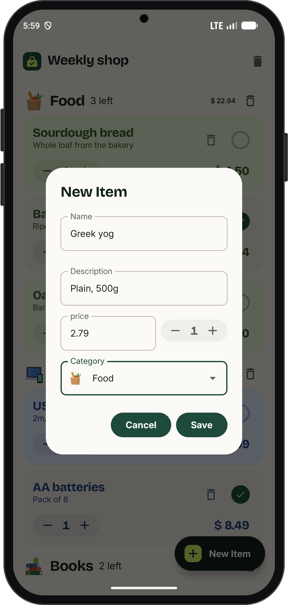 | 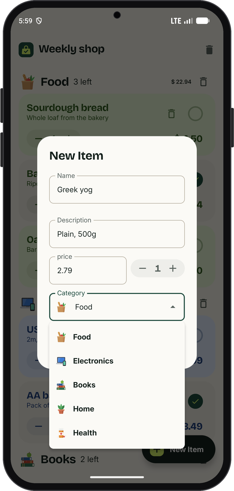 | 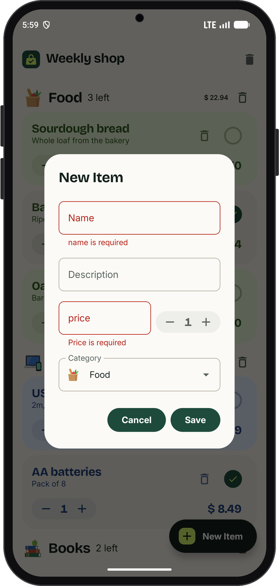 | 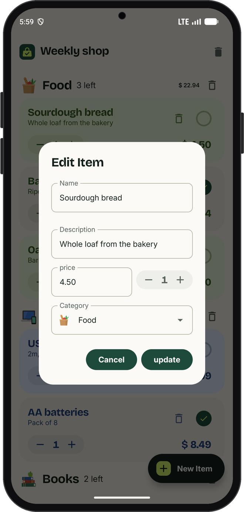 |
| 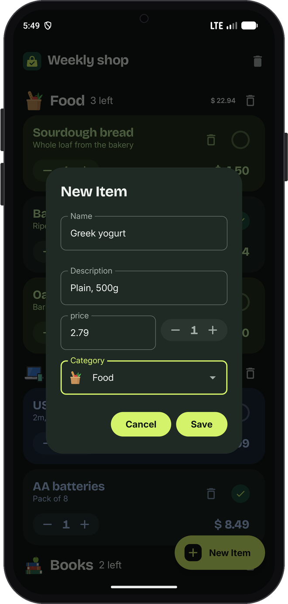 | 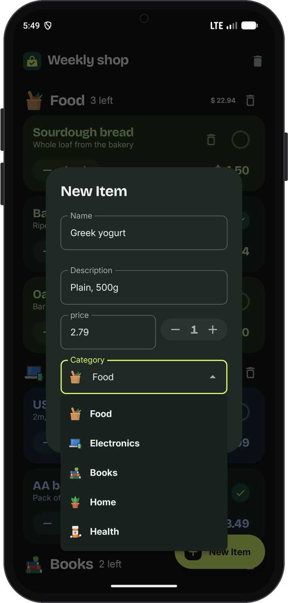 | 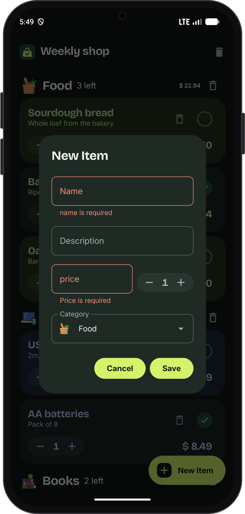 | 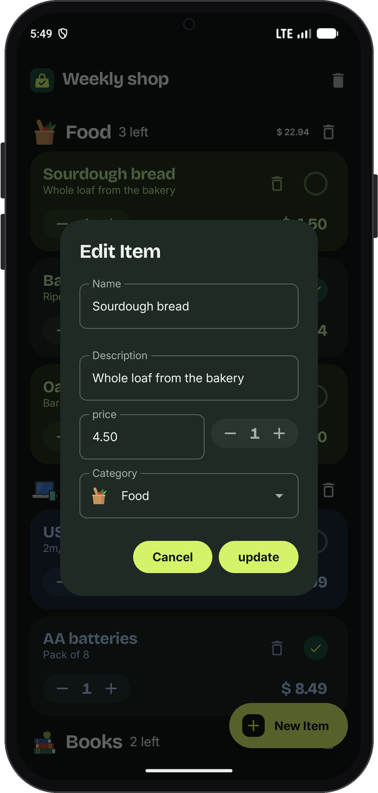 |

### Categories

Each category has its own illustration and color, plus a header with how many items are left and the category's total.

| Category | Light | Dark |
|:---|:---:|:---:|
| Food | 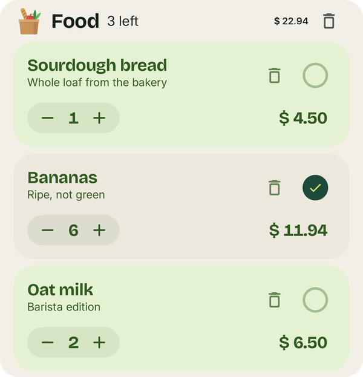 | 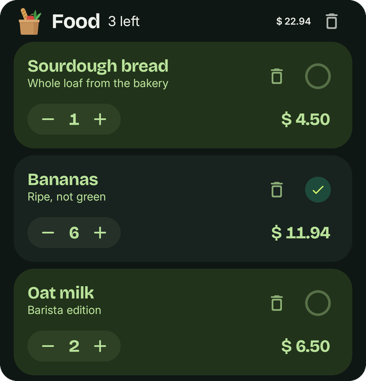 |
| Electronics | 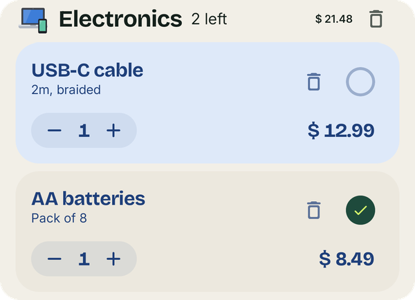 | 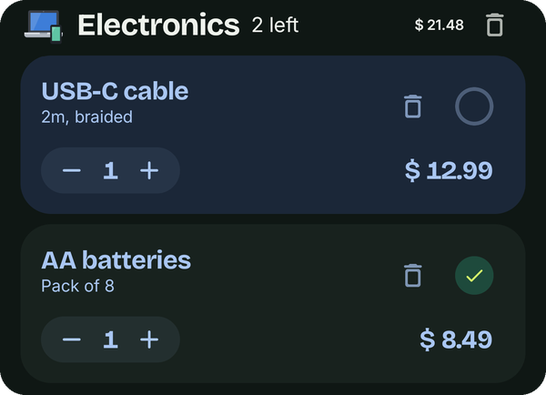 |
| Books | 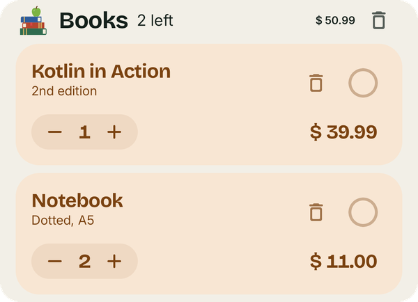 | 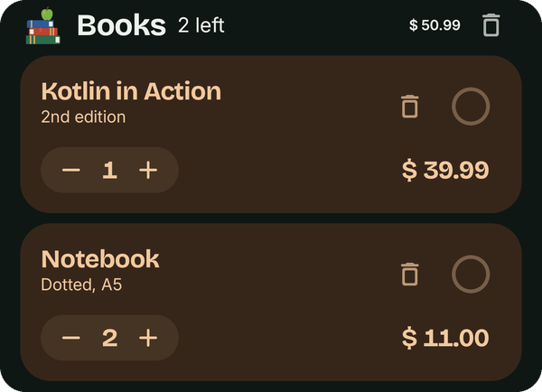 |
| Home | 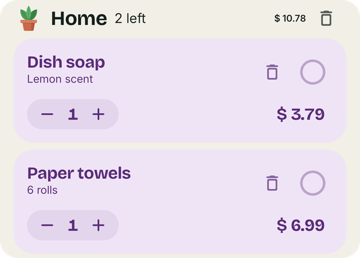 | 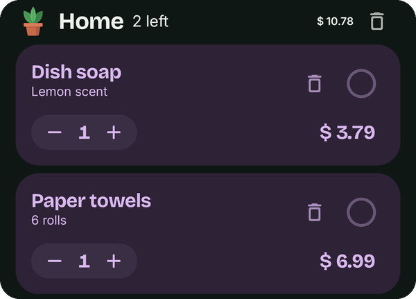 |
| Health | 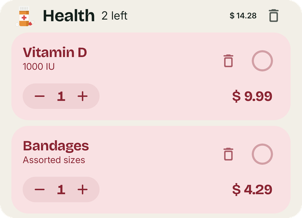 | 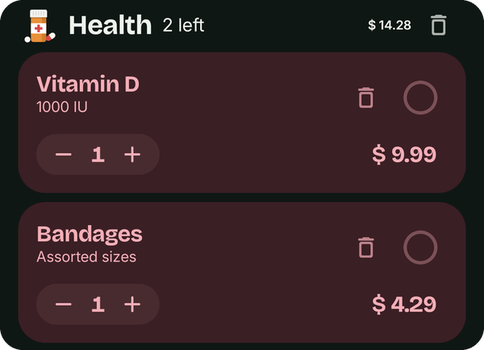 |

## Features

- **Animated launch screen** that cycles through the category illustrations before opening the list
- **List grouped by category** (Food, Electronics, Books, Home, Health), each with an illustrated icon, items-left count and price total
- **Add and edit items** with name, description, estimated price, quantity and category
- **Validation messages** for a missing name and a missing, non-numeric, zero or over-precise price
- **Mark items as bought** with a check circle; bought items switch to a muted card
- **Quantity stepper** on each item, with the line total updating as you change it
- **Delete** a single item, a whole category, or everything at once
- **Empty state** illustration when the tote is empty
- **Light and dark themes**
- **Saved on the device** with Room, so the list survives restarts

Editing an item resets it to "not bought" on purpose, since an edited item usually means something new to pick up.

## Tech stack

- Kotlin, Jetpack Compose and Material 3
- Navigation 3 for the splash → list flow
- Hilt for dependency injection
- Room for storage, exposed as a `Flow` and collected with `collectAsState`
- Coroutines (`viewModelScope`) for database writes
- AndroidX SplashScreen for the system launch screen

## Project structure

```
app/src/main/java/hu/ait/tote/
├── MainActivity.kt          # NavDisplay: splash → shopping list
├── MainApplication.kt       # @HiltAndroidApp
├── components/              # ItemCard, ItemDialog, CategoryDropdown, Stepper, top bar, FAB, price helpers
├── data/                    # Item entity, Category / Currency enums, ItemDao, AppDatabase
├── di/                      # Hilt module providing the database and DAO
├── navigation/              # Route keys
├── screen/
│   ├── shoppinglist/        # ShoppingListScreen + ShopListViewModel
│   └── splash/              # CustomSplashScreen
└── ui/theme/                # Colors, typography, category palettes
```

## Building

1. Open the project in Android Studio.
2. Let Gradle sync.
3. Run the `app` configuration on an emulator or a device running Android 7.0 (API 24) or newer.

Or from the command line:

```bash
./gradlew :app:installDebug
```
